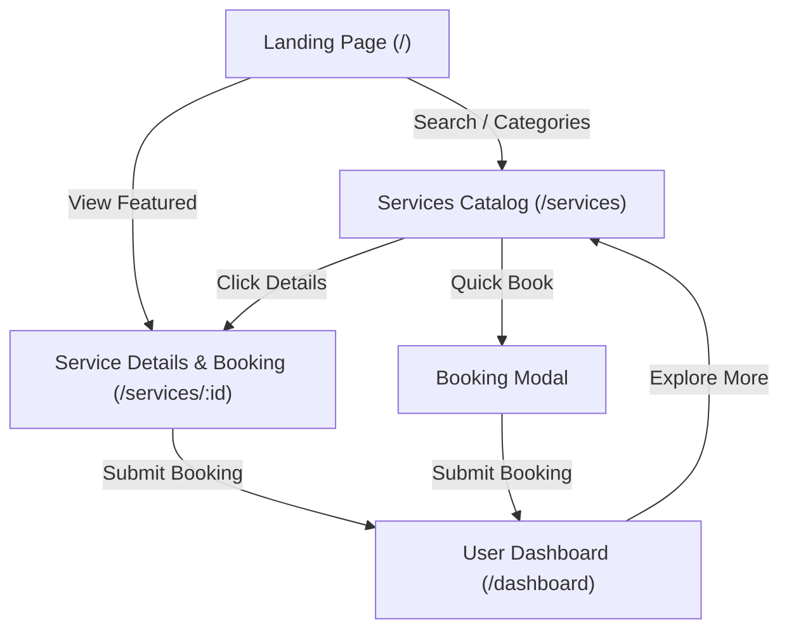

# NexoraFlow — Service Booking & Management Platform

[](https://github.com)
[](https://react.dev)
[](https://vitejs.dev)
[](https://oxc.rs)
[](https://developer.mozilla.org/en-US/docs/Web/CSS)

**NexoraFlow** is a modern, responsive, on-demand service booking and management web application built for the **YUVA Internship Week 2 Deliverable**. It connects residential and commercial clients with verified professionals across home cleaning, plumbing, electrical inspections, HVAC appliance repairs, and smart home technologies.

---

## 🌟 Week 2 Completed Requirements Summary

All deliverables specified in the YUVA Internship Week 2 curriculum have been implemented, tested, and validated:

1. **Professional Landing Page (`/`)**:
   - Modern hero section with quick search bar and immediate category filters.
   - Live trust metrics strip (2,500+ experts, 4.9/5 rating, 99.4% on-time arrival, 100% upfront pricing).
   - Interactive category pill grid linking directly to filtered views.
   - Featured popular services with instant booking and detail view actions.
   - 4-step *"How It Works"* visual workflow.
   - Trust and benefits grid highlighting background checks, pricing transparency, and warranty.
   - Sample client demonstration testimonials and bottom CTA banner.

2. **Professional Service Catalog & Search (`/services`)**:
   - Instant search by service name, description keywords, category, or provider.
   - Category filtering bar (Home Cleaning, Electrical, Plumbing, Appliance Repair, Smart Home & Tech, Painting & Carpentry).
   - Price tier filtering (All, Under $80, $80 - $130, $130+).
   - Dynamic sorting (Featured/Recommended, Price: Low to High, Price: High to Low, Highest Rated).
   - Filter active indicators and one-click filter reset with empty-state recovery.

3. **Dedicated Service Details and Booking Page (`/services/:serviceId`)**:
   - Breadcrumb navigation (`Home > Services Catalog > Service Name`).
   - Detailed service inclusions checklist and technical scope.
   - Verified provider badge, rating, years of experience, and completed job metrics.
   - Frequently Asked Questions (FAQs) and 100% Satisfaction Guarantee banner.
   - Sticky interactive booking form with arrival slot selector, real-time input validation, transparent pricing breakdown, and one-click booking submission.

4. **User Dashboard (`/dashboard`)**:
   - 4 live summary metric cards (Total, Pending, Completed, Cancelled).
   - Filter tabs by booking status (`All`, `Confirmed`, `Pending`, `Completed`, `Cancelled`) with live counts.
   - Table search filter matching Booking ID, service title, or provider.
   - Responsive presentation: desktop data table and mobile/tablet responsive card views.
   - Action buttons: View full booking receipt modal, cancel active bookings with confirmation, and one-click demo data reset.

5. **Form Validation & Booking Interactions**:
   - Input validation for Customer Name (min 3 chars), Email format, Phone number format, Service Street Address (min 8 chars), and Appointment Date (cannot be in the past).
   - Interactive arrival time slot selector chips.
   - Price calculation showing base fee, safety/dispatch surcharge ($5.00), and taxes (8%).
   - Auto-generated unique reference IDs (e.g., `NXF-892104`).
   - Booking confirmation modal with copy-to-clipboard reference ID and ESC key dismiss.
   - Global auto-dismissing toast notification system for user actions.

6. **Responsive Design & Accessibility**:
   - Tested and verified for desktop (1280px+), tablet (768px - 992px), and mobile (375px - 640px).
   - Mobile hamburger navigation drawer with quick booking CTA.
   - Keyboard accessibility (ESC key to dismiss modals, visible focus outlines, ARIA roles).

---

## 🛠️ Technology Stack

| Layer | Technology | Version | Purpose |
| :--- | :--- | :--- | :--- |
| **UI Framework** | React | `^19.3.1` | Component-based reactive user interface |
| **Routing** | React Router DOM | `^7.18.4` | Client-side page navigation with HashRouter |
| **Bundler & Dev Server** | Vite | `^8.3.4` | Lightning-fast HMR and production bundling |
| **Styling** | Vanilla CSS3 | Standard | Custom design system, CSS variables, glassmorphic dark theme |
| **Icons** | Lucide React | `^1.61.0` | Crisp, scalable SVG vector iconography |
| **Linting & Code Quality** | Oxlint | `^1.88.0` | Modern, high-performance static analysis |
| **State & Persistence** | React Context + LocalStorage | Native | Autonomous state with browser persistence |

---

## 📦 Mock Data & Backend Status

> [!NOTE]
> **Backend Integration Documentation**
> - In accordance with Week 2 internship requirements, **NexoraFlow operates as an autonomous client-side application** powered by verified mock data (`src/data/servicesData.js`) and browser `localStorage` persistence.
> - **No external backend server is required to run the project.**
> - All new bookings created by the user are saved under the browser `localStorage` key `nexoraflow_bookings` and persist across page refreshes.
> - A **"Reset Demo Data"** button is provided on the dashboard to easily restore initial sample bookings at any time.

### How to Connect a Real Backend API in the Future
To connect a real REST or GraphQL backend API:
1. Replace the state methods in `src/context/BookingContext.jsx` (`createBooking`, `cancelBooking`, `markBookingCompleted`) with `fetch()` or `axios` calls to your API endpoints (e.g., `POST /api/bookings`, `PATCH /api/bookings/:id`).
2. Fetch services from `GET /api/services` inside a `useEffect` on application mount.
3. The component hierarchy, form validations, and routing are already decoupled and ready for drop-in API integration.

---

## 🚀 Quick Start & Local Setup Instructions

Follow these exact steps to run NexoraFlow locally on your machine.

### Prerequisites
- **Node.js**: v18.0.0 or higher ([Download Node.js](https://nodejs.org/))
- **npm**: v9.0.0 or higher (comes bundled with Node.js)

### Step 1: Open the Project Directory
Open your terminal (PowerShell, Command Prompt, or Terminal) and navigate to the project directory:
```bash
cd c:\Users\VENKATESH.A\Documents\NexoraFlow_YUVA_Week2
```

### Step 2: Install Dependencies
Install all required packages:
```bash
npm install
```

### Step 3: Start the Development Server
Launch the local Vite development server:
```bash
npm run dev
```
The terminal will display the local URL:
```text
  VITE v8.3.5  ready in 1360 ms

  ➜  Local:   http://localhost:5173/
  ➜  Network: use --host to expose
```
Open your browser and navigate to `http://localhost:5173/`.

### Step 4: Run Code Linter
Verify that all files are free from lint errors and warnings:
```bash
npm run lint
```
*Expected output: `Found 0 warnings and 0 errors.`*

### Step 5: Build for Production
To generate the optimized production bundle:
```bash
npm run build
```
The production assets will be generated in the `dist/` directory.

### Step 6: Preview Production Build (Optional)
To test the built production bundle locally:
```bash
npm run preview
```

---

## 📁 Project Directory Structure

```text
NexoraFlow_YUVA_Week2/
├── index.html                   # HTML5 entry template with Plus Jakarta Sans & Inter fonts
├── package.json                 # Project dependencies, scripts, and metadata
├── package-lock.json            # Exact lockfile for deterministic installs
├── vite.config.js               # Vite bundler configuration with React plugin
├── .oxlintrc.json               # Oxlint static code analysis configuration
├── .gitignore                   # Git exclusion rules (node_modules, dist, etc.)
├── README.md                    # Comprehensive project documentation
├── public/                      # Static assets
└── src/
    ├── main.jsx                 # React root renderer
    ├── App.jsx                  # Main application layout, routing & global modal mounts
    ├── index.css                # Master design system (colors, glassmorphism, responsive CSS)
    ├── App.css                  # Component-specific styles
    ├── context/
    │   └── BookingContext.jsx   # Global state, booking actions, metrics, and localStorage sync
    ├── data/
    │   └── servicesData.js      # Curated catalog (8 services, 6 categories, demo bookings & reviews)
    ├── pages/
    │   ├── LandingPage.jsx      # Marketing hero, categories, featured services, workflow, testimonials
    │   ├── ServicesPage.jsx     # Service directory with instant search, category & price filters
    │   ├── ServiceDetailPage.jsx# Dedicated service details & interactive booking page
    │   └── DashboardPage.jsx    # User dashboard with metrics, booking table, tabs, and actions
    └── components/
        ├── Navbar.jsx           # Responsive header with navigation links, badge & user profile menu
        ├── Footer.jsx           # Platform footer with category links and internship attribution
        ├── ServiceCard.jsx      # Reusable service card with direct detail page links & quick booking
        ├── ServiceDetailModal.jsx# Quick-preview modal with inclusions and FAQs
        ├── BookingModal.jsx     # Validated modal booking form with arrival slot selector
        ├── BookingConfirmationModal.jsx # Booking success modal with copyable reference ID
        ├── BookingDetailModal.jsx   # Detailed receipt and status management modal
        └── Toast.jsx            # Non-blocking notification alerts
```

---

## 📱 Pages & User Flow Overview



1. **Discovery**: User explores services on the Landing Page (`/`) or searches the full Catalog (`/services`).
2. **Evaluation**: User clicks on a service card to inspect the full scope, inclusions, provider rating, and FAQs on the dedicated Service Details Page (`/services/:id`).
3. **Reservation**: User fills out the booking form, selects their preferred arrival window, and confirms the reservation.
4. **Tracking**: User tracks their appointment status (`Confirmed`, `Pending`, `Completed`, `Cancelled`) on the live Dashboard (`/dashboard`).

---

## 🛡️ Quality Assurance & Test Verification

- **Linter Check**: Tested with `oxlint` — **0 warnings, 0 errors**.
- **Production Build**: Built with `vite build` — **Success (1954 modules transformed, 0 errors)**.
- **Form Validation**: Tested with empty inputs, invalid emails, invalid phone numbers, and past dates — all correctly caught with inline error alerts.
- **Cross-Device Testing**: Verified on Desktop (1920x1080), Tablet (768x1024), and Mobile (375x667).

---

## 👨‍💻 Developer & Internship Attribution

- **Project**: NexoraFlow — Service Booking & Management Platform
- **Program**: YUVA Internship Program (Week 2 Frontend Deliverable)
- **Developer**: Venkatesh A.
- **Date**: October 2026
- **License**: MIT (for educational & evaluation purposes)
